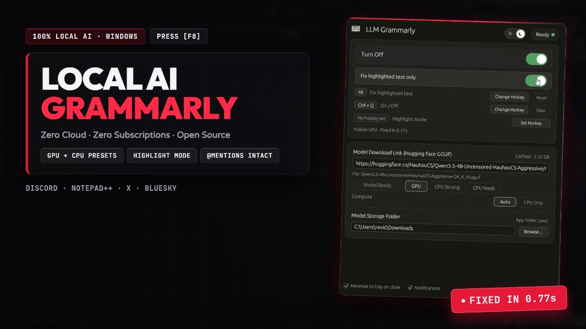

# LLM-Grammarly

A fast, local, private Windows & macOS grammar and spelling corrector written in Rust (`eframe`/`egui` + embedded `llama.cpp` with Vulkan GPU on Windows, Apple Metal GPU on macOS, and automatic CPU fallback on both).

Use **Live Fix** to press a system-wide hotkey in any text field, or switch to **Review Docs** to inspect and apply local AI fixes across `.txt`, `.md`, and `.docx` files with word diffs, formatting preservation, and automatic backups — no cloud APIs, no Python runtime, and no external Ollama server required.

---

## Demo Video

[](https://www.youtube.com/watch?v=4ZISeBYMDA8)

▶ **[Watch the demo on YouTube](https://www.youtube.com/watch?v=4ZISeBYMDA8)** — GitHub download & unblock, GPU/CPU presets & compute modes, one-click Hugging Face download, Notepad++ Highlight Mode, live Discord `@mention` demo, and Review Docs (`.docx` batch diffs, whole-file fix & timestamped backups).

---

## Download & Launch on macOS (Universal — Apple Silicon & Intel)

A single self-contained Universal macOS `.app` (`arm64` + `x86_64`, macOS 12+) with Apple Metal GPU shaders and `llama.cpp` compiled directly into the binary — no Homebrew libraries, Python, or Ollama required:

- **Direct Download (Latest macOS)**: [`LLM-Grammarly-macOS.dmg`](https://github.com/revisionhiep-create/LLM-Grammarly/releases/latest/download/LLM-Grammarly-macOS.dmg)
- **GitHub Releases (macOS & Windows)**: [Latest Release](https://github.com/revisionhiep-create/LLM-Grammarly/releases/latest) · [All Releases](https://github.com/revisionhiep-create/LLM-Grammarly/releases)

### Launching on macOS

1. **Download [`LLM-Grammarly-macOS.dmg`](https://github.com/revisionhiep-create/LLM-Grammarly/releases/latest/download/LLM-Grammarly-macOS.dmg)** from GitHub Releases and double-click it in **Finder**.
2. **Drag `LLM-Grammarly.app` into `Applications`**.
3. **Allow the unsigned open-source app on first launch**:
   - Double-click **LLM-Grammarly** in **Applications** (if macOS Gatekeeper warns about an unidentified developer, open **System Settings → Privacy & Security → Open Anyway**, or run `xattr -cr /Applications/LLM-Grammarly.app` in Terminal).
4. **Download the AI model on first launch**:
   - Click **Download & Turn On** in the app window (models are saved by default to `~/Library/Application Support/LLM-Grammarly/Models`, or click **Browse...** first to choose another folder).
   - Once loaded, the status badge turns **green** (**Ready**) with **Metal GPU** (or **CPU** fallback).
5. **Grant Accessibility permission for Live Fix**:
   - When prompted (or via the **Open Settings...** button inside the app), enable **LLM Grammarly** under **System Settings → Privacy & Security → Accessibility** so Live Fix can read (`Cmd+C`) and replace (`Cmd+V`) text in other apps.
   - *(Note: **Review Docs** for `.txt`, `.md`, and `.docx` files works immediately without Accessibility permission.)*
6. **Start fixing text anywhere**:
   - **Live Fix tab**: Place your cursor in any app and press **`Ctrl + Shift + G`** (default macOS hotkey; avoids MacBook media keys on `F8`, and can be rebound to any shortcut including `Cmd`/`Option`/`Ctrl`/`Shift` or `F1`–`F12`).
   - **Review Docs tab**: Drag-and-drop or browse for a `.txt`, `.md`, or `.docx` document for batch offline diffing and timestamped backups.

---

## Download & Launch on Windows (File Explorer)

No installation, Python, or external dependencies required — just download and run:

- **Direct Download (Latest Windows)**: [`LLM-Grammarly.exe`](https://github.com/revisionhiep-create/LLM-Grammarly/raw/main/LLM-Grammarly.exe) (Windows 10/11 64-bit; Vulkan GPU recommended, automatic CPU fallback built in)
- **Release Archive**: [GitHub Releases](https://github.com/revisionhiep-create/LLM-Grammarly/releases)

### Launching via File Explorer

1. **Download `LLM-Grammarly.exe`** from the link above.
2. **Open File Explorer** (press **`Win + E`** or click the folder icon on your taskbar) and go to your **Downloads** folder.
3. **Move `LLM-Grammarly.exe` to its own folder (recommended)** — for example, create `C:\Users\<YourName>\LLM-Grammarly` and drag `LLM-Grammarly.exe` into it.
   > **Why?** By default, the app stores its ~2.52 GB `.gguf` AI model and document `Backups\` folder alongside `LLM-Grammarly.exe` (automatically falling back to `%LOCALAPPDATA%\LLM Grammarly\Backups` if the `.exe` folder is read-only), so keeping it in a dedicated folder keeps your Downloads folder tidy.
4. **Double-click `LLM-Grammarly.exe`** to open the app.
   - **If Windows Defender SmartScreen appears** (*"Windows protected your PC"* because the open-source binary is unsigned): click **More info** → **Run anyway**.
   - Alternatively, right-click `LLM-Grammarly.exe` → **Properties** → check **Unblock** → click **OK**, then double-click to launch.
5. **Download the AI model on first launch**:
   - Click **Download & Turn On** in the app window (or click **Browse...** first if you want to store models in a different folder).
   - Once the download finishes and loads, the top toggle switch slides right and turns **green** (**Ready**).
6. **Start fixing text anywhere — or review whole documents**:
   - **Live Fix tab**: Click into any text box (browser, Discord/Slack, Notepad, email, IDE, etc.) and press **`F8`** (default hotkey) to fix spelling, grammar, and punctuation in place.
   - **Review Docs tab**: Switch to **Review Docs** below the header bar and drag-and-drop (or click **Browse File...**) to open a `.txt`, `.md`, or `.docx` file for chunked offline review.
   - *(Optional)* Right-click `LLM-Grammarly.exe` in File Explorer and choose **Pin to Start**, **Show more options → Pin to taskbar**, or **Create shortcut** for quick access later.

---

## Features

- **Self-Contained Portable Binaries (Windows & macOS)**:
  - **Windows**: Compiles into one portable `.exe` (`LLM-Grammarly.exe`) with `llama.cpp` and Vulkan shaders compiled directly in, linking only standard Windows OS / MSVC runtime libraries and `vulkan-1.dll`.
  - **macOS**: Compiles into a self-contained Universal `.app` (`LLM-Grammarly-macOS.dmg` supporting both Apple Silicon `arm64` and Intel `x86_64`) with `llama.cpp` and Apple Metal kernels (`GGML_METAL_EMBED_LIBRARY=ON`) embedded inside the binary, linking only macOS system frameworks.
- **Default Uncensored Local Model**: Ships configured for `HauhauCS/Qwen3.5-4B-Uncensored-HauhauCS-Aggressive` (`Qwen3.5-4B-Uncensored-HauhauCS-Aggressive-Q4_K_M.gguf`, ~2.52 GB) running in fast non-thinking mode (`<think>\n\n</think>\n\n`), preserving original meaning, tone, names, slang, profanity, and line breaks. Also supports custom GGUF models via embedded chat templates or ChatML fallback.
- **Customizable System-Wide Hotkeys**:
  - **Fix Text**: Defaults to **`F8`** on Windows and **`Ctrl + Shift + G`** on macOS; rebind live via **Change Hotkey** / **Reset** to any modifier combo (`Ctrl` / `Alt`/`Option` / `Shift` / `Cmd` + key) or standalone function key (`F1`–`F12`).
  - **Optional Mode & Power Toggle Hotkeys**: Assign global hotkeys for **On / Off** and **Highlight mode** (`No hotkey set` by default; assignable via **Set Hotkey** / **Change Hotkey**, removable via **Clear**, and saved in `settings.json`).
  - Waits for physical key/modifier release before copying (`Ctrl+A` → `Ctrl+C` on Windows, `Cmd+A` → `Cmd+C` on macOS, or copy-only in highlight mode), runs local LLM correction, pastes the result only if changed (or copies it to your clipboard with a notification if you switched windows/apps during inference), polls clipboard change sequences adaptively, and restores your previous clipboard text afterward.
- **Full-Box Clickable On / Off & Highlighted-Only Switches**:
  - Clean neutral UI featuring animated white (Off) / green (On) toggle pills where clicking anywhere inside the switch row toggles the setting.
  - **Turn On / Turn Off**: Turning **Off** unregisters the fix hotkey and unloads the model + KV cache to free GPU VRAM / system RAM immediately. Turning **On** loads the model, warms up GPU shaders (Vulkan on Windows, Apple Metal on macOS) or CPU inference, and activates the fix hotkey (optional **On / Off** and **Highlight mode** hotkeys stay active even while Off).
  - **Fix highlighted text only**: Located directly beneath Turn On / Turn Off (defaults to **Off** and saved in `settings.json`). When **On**, skips `Ctrl+A` / `Cmd+A` so only your currently highlighted selection is corrected and replaced.
- **Dark & Light Mode Switch**:
  - Top-right sun (left / Light Mode) and moon (right / Dark Mode) pill switch next to the status badge. Defaults to **Dark Mode** on first launch, syncs the native Windows/macOS title bar appearance, and saves your preference in `settings.json`.
- **Review Docs Tab (`.txt`, `.md`, `.docx`)**:
  - Switch between **Live Fix** and **Review Docs** directly beneath the top header bar.
  - **File Loading**: Load `.txt`, `.md`, or `.docx` documents via drag-and-drop or the native **Browse File...** dialog.
  - **Prompt Modes**: Choose **Spelling / Grammar Only** (strict typo, grammar, and punctuation fixes preserving wording and tone) or **Rewrite for Clarity** (improves flow, readability, and conciseness while keeping the original meaning).
  - **Review Scopes & Auto-Load**: Run **One Batch at a Time** (~260 target / 350 max words per batch without splitting paragraphs) to inspect diffs batch by batch, or **Fix Whole File** to process all batches sequentially while auto-accepting normal edits and flagging any chunk whose character length changes by more than `±25%` (`> ±25%`) for manual review. If the model is **Off** when started, clicking the primary Run button automatically loads your cached model first.
  - **Format & Structure Preservation**: `.txt` and `.md` files preserve original `CRLF`/`LF` line endings, and Markdown skips YAML frontmatter, fenced code blocks, image lines, HTML comments, and thematic breaks verbatim. `.docx` files patch `word/document.xml` text runs in place via word-diff alignment so styles, bold/italic formatting, `<w:hyperlink>` / `<w:ins>` run boundaries, tables, Word fields, tracked deletions (`<w:del>`), and embedded media are preserved intact.
  - **Diff Viewer, Progress & Cancellation**: Inspect **Inline** diffs (or **Side-by-side** diffs on windows `>= 700 px` wide), accept/reject individual items or click **Accept All in Batch**, monitor live batch percentage on the reused progress bar + Windows taskbar / macOS Dock badge, and abort cleanly mid-chunk with **Cancel** without touching the source file.
- **Backup Engine & Safe Atomic Saves**:
  - **File-Lock Pre-Check**: Probes exclusive write access (`share_mode(0)` on Windows; `flock` + Word `~$` lock file check on macOS) before loading or saving so you are warned immediately if a document is open in Microsoft Word or another app.
  - **Timestamped Non-Overwriting Backups**: **Save (with Backup)** copies the original file to `<name>_YYYY-MM-DD_HHMMSS.<ext>` (with `_1`, `_2` collision suffixes if needed) inside `Backups\` next to `LLM-Grammarly.exe` on Windows (falling back to `%LOCALAPPDATA%\LLM Grammarly\Backups`) or `~/Library/Application Support/LLM-Grammarly/Backups` on macOS (or any writable folder chosen in **Backup Settings**).
  - **Safe Auto-Pruning**: Enforces your **Keep last backups** limit (default `20`, range `1`–`500`, saved in `settings.json`) after each save, deleting only managed timestamped backup filenames while leaving unrelated files untouched.
  - **Atomic `.tmp` Write & Validation**: Writes updates to a temporary file, verifies non-empty UTF-8 (`.txt`/`.md`) or valid ZIP/`word/document.xml` (`.docx`), swaps atomically (`ReplaceFileW` on Windows, POSIX `rename` on macOS), and also provides **Save As...** (locked to the same document extension) to export a copy without modifying the original.
- **Interactive Hugging Face GGUF Downloader**:
  - First-run and model-switching download panel showing progress percentage, transferred bytes, download speed (MB/s), and ETA.
  - Supports **Pause / Cancel Download** and **Resume** via `.gguf.part` partial files and HTTP `Range` requests, validates the `GGUF` magic header (`b"GGUF"`), automatically converts Hugging Face `/blob/` links to `/resolve/` URLs, and mirrors progress onto the Windows Taskbar button / macOS Dock badge.
- **Configurable Model URL, Compute Mode & Storage Folder**:
  - Edit the Hugging Face GGUF download link directly or pick one of the preset buttons (**GPU** for 4B uncensored ~2.52 GB, **CPU Strong** for 2B uncensored ~1.21 GB, or **CPU Weak** for LFM2.5-1.2B ~697 MB), switch **Compute** between **Auto** (Vulkan/Metal GPU with automatic CPU fallback) and **CPU Only**, and choose any **Model Storage Folder** via a native folder picker (**Browse...** / **Reset**). Defaults to the `.exe` folder on Windows and `~/Library/Application Support/LLM-Grammarly/Models` on macOS.
- **Native Desktop Integration (Windows & macOS)**:
  - Procedurally rendered neutral keyboard icon embedded into Windows PE resources (`windows/assets/icon.ico`), macOS `.app` bundle icon (`AppIcon.icns`), window chrome, and tray / menu bar icons.
  - **Windows**: Taskbar Hover Toolbar (`ITaskbarList3`) with **Turn On / Turn Off** and **Quit** thumbnail buttons, System Tray icon, silent Windows notifications, and single-instance mutex.
  - **macOS**: Native Menu Bar `NSStatusItem` with **Show Window**, **Turn On / Turn Off**, and **Quit LLM Grammarly**, Dock download badge, silent macOS notifications, and `flock`-based single-instance guard.
- **Multi-Monitor & Per-Monitor DPI Aware**:
  - Persists window size, screen coordinates, display placement, and maximized state in `settings.json` (`%APPDATA%\LLM Grammarly\config\settings.json` on Windows; `~/Library/Application Support/LLM-Grammarly/settings.json` on macOS), clamps safely onto visible displays if a monitor is disconnected, and scales cleanly across displays with different resolutions/DPI settings.

---

## Everyday Usage & Customization

1. **Turn On / Turn Off**:
   - Click anywhere inside the top **Turn On / Turn Off** toggle box (or use the system tray / menu bar icon menu / Windows taskbar hover buttons) to load or unload the model from GPU VRAM / system RAM and enable or disable the global hotkey.
2. **Fix Text Anywhere**:
   - Place your cursor in any text input and press your fix hotkey (default **`F8`** on Windows, **`Ctrl + Shift + G`** on macOS) to select and fix all text in place, or turn on **Fix highlighted text only** to skip `Ctrl+A`/`Cmd+A` and correct only highlighted text.
3. **Pause, Resume, or Switch Models**:
   - You can click **Pause / Cancel Download** mid-download (keeping the `.gguf.part` file to resume later via **Resume Download** / **Resume Download & Turn On**) or click **Discard partial file**.
4. **Customize Hotkeys, Model, or Storage Folder**:
   - **Hotkeys**: Click **Change Hotkey** on the fix row (or **Reset** to restore the platform default), and optionally click **Set Hotkey** / **Clear** on the **On / Off** and **Highlight mode** rows (`No hotkey set` by default).
   - **Model URL & Compute**: Paste any Hugging Face `.gguf` URL (`/blob/` or `/resolve/`), or click **GPU** (4B uncensored, ~2.52 GB), **CPU Strong** (2B uncensored, ~1.21 GB), or **CPU Weak** (LFM2.5-1.2B, ~697 MB) to switch presets, then click **Download Model** / **Switch Model**. Use **Compute** (**Auto** / **CPU Only**) to force CPU inference or reload the active model.
   - **Model Folder**: Click **Browse...** to choose another storage folder or **Reset** to use the default folder again.
   - **Tray / Menu Bar Behavior**: Enable **Minimize to tray on close** / **Keep in menu bar on close** or click **Hide to Tray** / **Hide to Menu Bar** to keep the app running quietly in the background.
   - **Notifications**: Toggle the **Notifications** checkbox in the footer to enable or disable silent OS notifications on **On / Off** and **Highlight mode** changes (enabled by default).
   - **Settings File**: Saved automatically at `%APPDATA%\LLM Grammarly\config\settings.json` (Windows) or `~/Library/Application Support/LLM-Grammarly/settings.json` (macOS).
5. **Review Documents (`Review Docs` tab)**:
   - Drag-and-drop a `.txt`, `.md`, or `.docx` file onto the window (or click **Browse File...**).
   - Select **Prompt Mode** (**Spelling / Grammar Only** or **Rewrite for Clarity**) and **Review Scope** (**One Batch at a Time** or **Fix Whole File**).
   - Click **Review Current Batch** (or **Fix Whole File**) to start inference — click **Cancel** at any time to stop safely without editing the file on disk.
   - Review the **Inline** or **Side-by-side** diffs, check any `> ±25%` length-change badges, use **Prev** / **Next** between batches, and click **Accept**, **Reject**, or **Accept All in Batch**.
   - Click **Save (with Backup)** to back up the original and overwrite in place atomically, or **Save As...** to save a new copy in the same format.
   - Expand **Backup Settings** at the bottom to change the backup folder (**Browse...** / **Reset**) or adjust **Keep last backups** (`1`–`500`, default `20`).

---

## Known Limitations

- **Facebook `@` mentions / tags**: Full select-all replacement (`Ctrl + A` → paste) does not preserve Facebook tags in posts or comments. Facebook stores mentions as rich-text objects tied to hidden user IDs rather than plain `@username` text, so pasting plain text turns the tag into unlinked text that will not notify the person.
  - **Workaround**: Turn on **Fix highlighted text only** and highlight only the text *excluding* the blue tag, or fix your text first and add the `@` tag last.
- **Other rich-text formatting (`Live Fix` tab)**: Because hotkey replacement pastes plain text via clipboard, rich formatting (such as bold/italic styling or masked hyperlinks) is stripped when replacing an entire field with **Live Fix**. Plain-text `@handle` mentions on platforms like Discord, X, and Bluesky still resolve normally when posted (on Discord, a pasted mention may look white in the compose box before sending, then turn blue and notify normally in chat). *(For Word documents, use the **Review Docs** tab to preserve `.docx` formatting in place.)*
- **Document review format scope (`Review Docs` tab)**: Supports `.txt`, `.md`, and `.docx` files (`.pdf` is not supported). `.docx` patching edits body and table paragraphs in `word/document.xml` while leaving Word fields (`fldSimple`/`fldChar`), tracked deletions (`<w:del>`/`<w:delText>`), headers/footers, and embedded assets untouched.

---

## CLI Self-Test

You can verify model caching/downloading, Vulkan GPU / CPU execution, warmup, inference latency, uncensored output, multiline preservation, and clean memory unloading from a terminal:

```powershell
.\LLM-Grammarly.exe --self-test
```

Options:
- `--model-dir "D:\Models"` — test against a custom model directory
- `--preset <gpu|cpu-strong|cpu-weak>` — select one of the built-in model presets
- `--model-url "<URL>"` — test a custom Hugging Face `.gguf` URL
- `--cpu` — force CPU-only inference instead of Auto (Vulkan GPU + CPU fallback)

```powershell
.\LLM-Grammarly.exe --self-test --model-dir "D:\Models" --preset cpu-strong --cpu
```

---

## Project Structure

```text
LLM-Grammarly/
├── .gitignore                        # Excludes target/, *.gguf, *.gguf.part, *.dmg, *.app/, other *.exe (tracks LLM-Grammarly.exe)
├── .github/
│   └── workflows/
│       └── release-macos.yml         # Universal macOS (arm64 + x86_64) build, otool check, .dmg & GitHub Release workflow
├── LLM-Grammarly.exe                 # Prebuilt Windows x64 portable executable
├── LICENSE                           # MIT License
├── README.md
├── assets/
│   └── demo-thumbnail.jpg            # YouTube demo thumbnail preview
├── windows/                          # Windows implementation (eframe + Win32 + Vulkan)
│   ├── Cargo.toml                    # Windows crate manifest & winresource metadata
│   ├── Cargo.lock                    # Locked Windows dependency graph
│   ├── build.rs                      # Generates windows/assets/icon.ico & embeds PE icon resource
│   ├── assets/
│   │   └── icon.ico                  # Multi-resolution neutral keyboard icon (16..256 px)
│   └── src/
│       ├── main.rs                   # Single-instance mutex, --self-test runner, eframe entrypoint
│       ├── app.rs                    # egui two-tab UI (Live Fix & Review Docs), diffs, settings
│       ├── controller.rs             # AppPhase state machine and background worker coordination
│       ├── doc_review.rs             # Document loader (.txt/.md/.docx), batcher, word diffing, review worker
│       ├── docx.rs                   # Formatting-preserving word/document.xml parser, patcher, ZIP validator
│       ├── backup.rs                 # Windows backup engine, file-lock pre-check, managed pruning, ReplaceFileW save
│       ├── widgets.rs                # Theme palette, custom toggle pills, progress bar, formatting helpers
│       ├── config.rs                 # settings.json persistence, HF URL normalization, hotkey/window/compute/backup config
│       ├── downloader.rs             # Streaming GGUF downloader with HTTP Range resume & magic validation
│       ├── hotkey.rs                 # Win32 RegisterHotKey loop, SendInput copy/paste, clipboard restore
│       ├── llm.rs                    # Embedded llama-cpp-2 worker (Grammar/Rewrite prompts, Vulkan/CPU fallback)
│       ├── taskbar.rs                # Win32 ITaskbarList3, tray icon/notifications, file/folder dialogs, monitor clamping
│       ├── icon.rs                   # Converts rendered RGBA icon buffers to egui/tray/Win32 HICON formats
│       └── icon_render.rs            # Pure-Rust anti-aliased procedural icon renderer shared with build.rs
└── macos/                            # macOS implementation (eframe + Cocoa/Carbon + Apple Metal)
    ├── Cargo.toml                    # macOS crate manifest (Metal GPU, OpenMP disabled for self-containment)
    ├── Cargo.lock                    # Locked macOS dependency graph
    ├── build.rs                      # Compiles macos_bridge.m, links Apple frameworks, generates .iconset PNGs
    └── src/
        ├── macos_bridge.m            # Objective-C ARC bridge (Carbon hotkeys, CGEvent, NSPasteboard, NSStatusItem, NSOpenPanel)
        ├── main.rs                   # flock single-instance guard, --version, --self-test, eframe entrypoint
        ├── app.rs                    # egui UI with macOS shortcuts, Accessibility prompt banner & Menu Bar controls
        ├── controller.rs             # AppPhase state machine and background worker coordination
        ├── doc_review.rs             # Document loader (.txt/.md/.docx), batcher, word diffing, review worker
        ├── docx.rs                   # Formatting-preserving word/document.xml parser, patcher, ZIP validator
        ├── backup.rs                 # macOS backup engine, flock / Word lock pre-check, atomic rename save
        ├── widgets.rs                # Theme palette, custom toggle pills, progress bar, formatting helpers
        ├── config.rs                 # ~/Library/Application Support/LLM-Grammarly settings, models & backups config
        ├── downloader.rs             # Streaming GGUF downloader with HTTP Range resume & magic validation
        ├── hotkey.rs                 # Carbon global hotkey controller, CGEvent Cmd+A/C/V & NSPasteboard restore
        ├── llm.rs                    # Embedded llama-cpp-2 worker (Apple Metal GPU / CPU fallback)
        ├── taskbar.rs                # NSStatusItem Menu Bar, Dock progress badge, notifications & native Cocoa panels
        ├── icon.rs                   # Converts rendered RGBA icon buffers to egui ViewportIcon
        └── icon_render.rs            # Pure-Rust anti-aliased procedural icon renderer shared with build.rs
```

> **Note**: Large model files (`*.gguf`, `*.gguf.part`) are excluded from git history via `.gitignore`. Prebuilt [`LLM-Grammarly.exe`](https://github.com/revisionhiep-create/LLM-Grammarly/raw/main/LLM-Grammarly.exe) is tracked directly on `main`, and Universal macOS builds (`LLM-Grammarly-macOS.dmg`) plus archived builds are published on [GitHub Releases](https://github.com/revisionhiep-create/LLM-Grammarly/releases/latest).

---

## Building from Source (Windows)

### Prerequisites

- **OS**: Windows 10 or Windows 11 (x64)
- **Rust Toolchain**: `stable-x86_64-pc-windows-msvc` via [rustup](https://rustup.rs/)
- **Visual Studio 2022 Build Tools**: `Desktop development with C++` workload (provides MSVC `cl.exe`, Windows SDK, CMake, and Ninja)
- **LLVM**: Install LLVM for Windows so `bindgen` can locate `libclang.dll` (typically `C:\Program Files\LLVM\bin`)
- **Vulkan SDK**: Install the LunarG [Vulkan SDK](https://vulkan.lunarg.com/) for Windows (`glslc.exe`, headers, and `vulkan-1.lib`)

### Build Commands

When compiling `llama-cpp-2` with the `vulkan` feature on Windows, use **Ninja** from a **VS 2022 x64 Developer environment** and a short `CARGO_TARGET_DIR` path. (Using Ninja avoids CMake 4.x / MSBuild parallel `CustomBuild` ordering issues when building `ggml-vulkan`'s `vulkan-shaders-gen` tool.)

From **cmd.exe** inside `windows\` (adjust `VULKAN_SDK` / `LIBCLANG_PATH` paths to match your machine):

```bat
cd windows
call "C:\Program Files (x86)\Microsoft Visual Studio\2022\BuildTools\Common7\Tools\VsDevCmd.bat" -arch=amd64 -host_arch=amd64
set "CMAKE_GENERATOR=Ninja"
set "LIBCLANG_PATH=C:\Program Files\LLVM\bin"
set "VULKAN_SDK=%LOCALAPPDATA%\VulkanSDK\1.4.363.0"
set "PATH=%VULKAN_SDK%\Bin;%PATH%"
set "CARGO_TARGET_DIR=C:\kbllm_target"

cargo test
cargo build --release
```

Cargo builds the release binary at `C:\kbllm_target\release\keyboard-llm.exe` (matching the package name in `windows/Cargo.toml`), which you can copy and rename to `LLM-Grammarly.exe`.

---

## Building from Source (macOS)

### Prerequisites

- **OS**: macOS 12+ (Apple Silicon `arm64` or Intel `x86_64`)
- **Xcode Command Line Tools**: `xcode-select --install` (provides `clang`, Metal compiler, and Apple SDK frameworks)
- **Rust Toolchain**: `stable` via [rustup](https://rustup.rs/)
- **CMake**: `brew install cmake` (required at build time only; zero runtime dependencies)

### Build Commands

From **Terminal** inside `macos/`:

```bash
cd macos
export MACOSX_DEPLOYMENT_TARGET=12.0
export CMAKE_OSX_DEPLOYMENT_TARGET=12.0
export GGML_METAL_EMBED_LIBRARY=ON
export GGML_NATIVE=OFF

cargo test
cargo build --release
```

Cargo builds a self-contained binary at `macos/target/release/LLM-Grammarly` with Apple Metal shaders embedded directly in the executable (verified with `otool -L`). To create a Universal `.app` bundle and `.dmg`, see [`.github/workflows/release-macos.yml`](.github/workflows/release-macos.yml).

---

## License

This project is licensed under the [MIT License](LICENSE).
